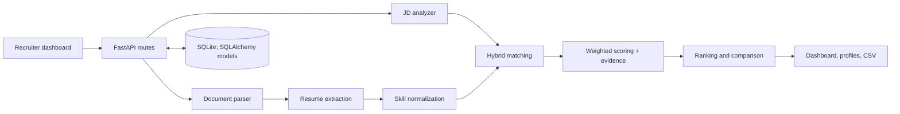

# TalentIQ — AI Recruitment Intelligence

TalentIQ is a local, evidence-focused resume screening prototype. It extracts job requirements and resume facts, scores candidates against five visible dimensions, ranks results, and explains the evidence behind each score. It avoids protected characteristics and keeps uploaded documents on the local machine.

## Start locally

Python 3.10+ is required. From this folder:

```powershell
python -m venv .venv
.venv\Scripts\Activate.ps1
pip install -r requirements.txt
uvicorn app.main:app --reload
```

Open http://127.0.0.1:8000. Interactive API documentation is at `/docs`. The database and uploaded originals are created in `data/`. Set `TALENTIQ_DATA_DIR` and `MAX_FILE_BYTES` to change those locations and the 8 MB default limit.

## Workflow

1. Paste a job description and create a role.
2. Inspect the extracted required and preferred skill chips.
3. Select multiple PDF, DOCX, or TXT resumes at once (10+ are supported).
4. Review ranking, open an evidence profile, compare selected candidates, or export CSV.

The API supports job CRUD reads/create, bulk upload, candidate profiles and explanations, compare, delete, ranked results, and CSV export. Upload failures are recorded per file and do not interrupt the batch. Exact duplicate file contents within one job are skipped. Files are limited by extension and size.

## Architecture



## Matching and scoring

The initial configurable weights are required skills 35%, semantic relevance 25%, relevant experience 20%, education 10%, and preferred skills 10%. Each component is normalized to 0–100 before the weighted sum. Required skills get credit only when normalized aliases occur in extracted text; semantic similarity can identify possible related evidence but cannot turn a missing hard skill into a confirmed match. Experience scores cap at the JD requirement. Unavailable evidence remains unknown and is shown as unverified.

When installed and the `all-MiniLM-L6-v2` model is already available locally, Sentence Transformers produces cosine similarities. The app does not fetch model weights at runtime. If no local model is present, it uses a deterministic token-overlap fallback. This fallback is a prototype signal, not a validated semantic model. Skill aliases normalize spelling and common abbreviations but intentionally do not equate distinct technologies.

## Sample data and privacy

`sample_resumes/` contains ten synthetic text resumes for demonstration. They contain fictional names and contact information. Delete a resume from the ranking table to remove its original upload and candidate record. The app does not log extracted personal information. This prototype is not an automated hiring decision system; recruiters should verify evidence and assess candidates fairly.

## Limitations and next steps

The prototype uses heuristic extraction and a compact skill dictionary; experience dates and nuanced education equivalencies are not fully resolved. It does not perform OCR on scanned PDFs. The current browser UI is a dependency-light dashboard served by FastAPI to make a local demo easy to run; a production deployment should use a compiled React/TypeScript client, authentication, authorization, retention controls, migrations, audit events, malware scanning, calibrated multilingual embeddings, and evaluation on consented, representative data. Scores are decision support and require human review.
